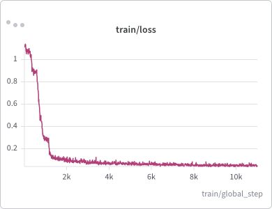
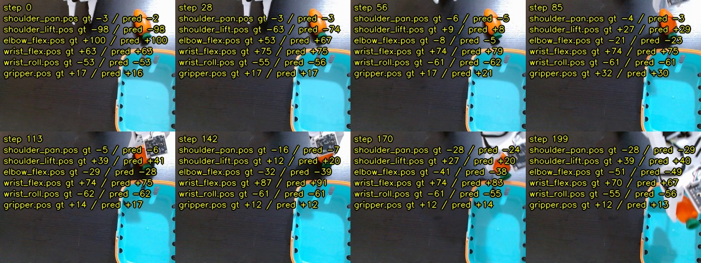
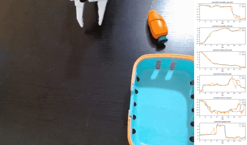

The recorded SO-101 trajectories become useful only after their cameras, state, and action meanings are made legible to the VLA.

[Part I](/blog/building-a-dual-arm-so-101-pipeline/) established the physical loop: leader-follower teleoperation, camera bring-up, and a carrot-to-box dataset. This part carries that dataset into a GR00T N1.7 post-training run. The purpose is not to claim a general SO-101 policy from a small, single-task dataset. It is to establish the next link in the pipeline: a validated path from recorded trajectories to a model that can be trained and evaluated on their visual and action interface.

The broader LoRA-family analysis—why a GR00T projector needs a custom adapter, and how LoRA, QLoRA, and DoRA compare on LIBERO—is in [VLA Post-Training Part I](/blog/vla-post-training-lora-family/). This note focuses on the SO-101-specific work.

## What the Model Receives

The [`Franc1sF/record-test`](https://huggingface.co/datasets/Franc1sF/record-test) dataset contains 102 teleoperated carrot-to-box episodes, a fixed third-person camera, and a wrist camera. I use 92 episodes for training and retain 10 episodes as a held-out evaluation split. The action/state schema is six-dimensional:

\[
q=(q_{\mathrm{shoulder\ pan}},q_{\mathrm{shoulder\ lift}},q_{\mathrm{elbow}},q_{\mathrm{wrist\ flex}},q_{\mathrm{wrist\ roll}},q_{\mathrm{gripper}}).
\]

This order already matched the available SO-101 modality definition. The camera keys did not. The recordings used `observation.images.third_view` and `observation.images.left_wrist`, while the GR00T configuration expects abstract `front` and `wrist` roles. The mapping below was chosen after decoding and checking the two camera streams: the third view sees the workspace, while the wrist view looks between the gripper fingers.

  
Show the SO-101 camera mapping

  <pre><code>{
  "video": {
    "front": {"original_key": "observation.images.third_view"},
    "wrist": {"original_key": "observation.images.left_wrist"}
  }
}</code></pre>

This mapping is not a cosmetic rename. It determines which visual role is associated with each video stream during training and later inference. A mismatched camera role can make an apparently valid dataset semantically wrong for the policy.

## From LeRobot Dataset to GR00T Input

The dataset was recorded in the LeRobot v3.0 layout, which stores multi-episode parquet and video assets together. The GR00T data loader used for this run expected LeRobot v2.1 path templates with one episode per file. It therefore could not read the v3.0 paths directly. The upstream v3-to-v2 conversion utility was used before fine-tuning.

This is the first post-training lesson from the hardware pipeline: data compatibility has two layers. A dataset must be syntactically readable, but it must also preserve the intended camera, state, and action semantics. Converting a file layout addresses only the first layer.

The SO-101 is registered as GR00T's `new_embodiment` rather than receiving a dedicated pretrained category. In the generic checkpoint, the selected category-specific projector slice is an untrained initialization. The full-scope LoRA setup therefore learns a compact embodiment map for this target while adapting shared action and visual-language layers. The details of that custom projector adapter are discussed in [VLA Post-Training Part I](/blog/vla-post-training-lora-family/#what-lora-must-reach-in-gr00t).

## The Fine-Tuning Configuration

The run uses a rank-16 full-scope LoRA configuration. “Full scope” means the action-DiT, visual-language self-attention, and the category-specific state/action projector are adapted; visual-language layer normalization remains trainable. This matters more than the label “LoRA” alone, because a DiT-only adapter would leave the target embodiment interface unchanged.

| Setting | Value |
| --- | --- |
| Base model | GR00T N1.7-3B generic checkpoint |
| Dataset | [`Franc1sF/record-test`](https://huggingface.co/datasets/Franc1sF/record-test): 102 episodes, one task, two cameras; 92 training / 10 held-out |
| Optimization | 10,000 steps; cosine schedule; 5% warmup; learning rate 1e-4 |
| Batch | Global batch 32 |
| Hardware | NVIDIA RTX GPUs |
| Adapter | Rank 16; alpha 32; dropout 0.05; full scope |
| Data loading | Two workers |

  
Show the LoRA launch arguments

  <pre><code>--use_action_lora \
--action_lora_scope full \
--action_lora_rank 16 \
--action_lora_alpha 32 \
--action_lora_dropout 0.05</code></pre>

The two-worker setting is intentional. Higher worker counts caused host-memory pressure in this small video dataset. This is a useful operational distinction: PEFT reduces the trainable-model and optimizer footprint, but it does not remove host memory consumed by video decoding, sharding, and prefetching.

## What the Training Curve Establishes

<figure class="article-figure-wide">
  
  <figcaption>Figure 1. Trainer-reported training loss for the SO-101 carrot-to-box fine-tuning run.</figcaption>
</figure>

The final trainer-reported average loss was 0.0391. This confirms that the full path—dataset conversion, modality mapping, embodiment configuration, custom adapter, and flow-matching training—optimizes on the training distribution.

The training data consist of teleoperated demonstrations. The example below is one trajectory from the training split, shown to make the visual input and carrot-to-box motion concrete.

<figure class="article-figure-wide">
  <video controls playsinline preload="metadata">
    <source src="training-example.mp4" type="video/mp4">
  </video>
  <figcaption>Figure 2. A carrot-to-box teleoperation trajectory from the training split.</figcaption>
</figure>

It does <em>not</em> establish closed-loop robot success. The held-out trajectories test prediction on recordings excluded from optimization, but they are not physical policy rollouts and do not measure recovery after a missed grasp or a changed object pose. With a single workspace and task, low training loss remains only an in-distribution fit signal.

<figure class="article-figure-wide">
  
  <figcaption>Figure 3. Sampled frames from a held-out trajectory, with ground-truth and predicted joint positions.</figcaption>
</figure>

<figure class="article-figure-wide">
  
  <figcaption>Figure 4. A held-out trajectory with synchronized camera view and joint traces.</figcaption>
</figure>

The held-out examples provide a qualitative check that predicted joint trajectories track the recorded action sequence over a full episode. The appropriate next evaluation is still a repeated closed-loop protocol: fixed initial configurations, a defined success criterion, multiple trials, and separate reporting for grasp, placement, and full-task completion. Only that experiment can test whether the trained policy connects its offline fit to useful physical behavior.

## Deploying the Adapter on the Robot

Training ran remotely on NVIDIA RTX GPUs, while real-robot inference ran on a separate local workstation connected to the SO-101 and its two cameras. This boundary exposed a distinction that is easy to miss during training: a resumable Trainer checkpoint is not the same thing as a deployable policy package.

The full `checkpoint-N` directory is about 985 MB because it retains optimizer shards, scheduler state, and random-number-generator state needed to resume distributed training. The robot client needs only the policy adapter and its runtime metadata: `adapter_model.safetensors`, `adapter_config.json`, `processor_config.json`, `statistics.json`, and `embodiment_id.json`. This reduced package is approximately 50–65 MB; the 6.5 GB GR00T base model remains external and can be fetched on the target machine.

The portability-critical field is `base_model_name_or_path` in `adapter_config.json`. Training writes an absolute path to the local base-model checkout by default. Before transfer, it must resolve to a model available on the deployment machine:

  
Show the portable adapter setting

  <pre><code>{
  "base_model_name_or_path": "nvidia/GR00T-N1.7-3B"
}</code></pre>

The target workstation used an NVIDIA RTX GPU. I therefore checked its CUDA capability before starting the server, rather than assuming that a training environment would transfer unchanged:

  
Show the target-GPU compatibility check

  <pre><code>python -c "import torch; print(torch.cuda.get_device_capability(0))"</code></pre>

Two client-side contracts are equally important. The instruction must match the recorded task string exactly—`Grab carrot and place in the box`—because this small post-training dataset contains no paraphrase coverage. The physical camera roles must also preserve the training mapping: the scene camera is `front` (the dataset's `third_view`) and the gripper camera is `wrist` (the dataset's `left_wrist`). Neither mismatch produces an interface error; both can instead appear as an unexplained policy failure.

## Closed-Loop Rollouts and Three Lessons

The held-out trajectories above assess whether the model tracks actions in logged data. The videos below are closed-loop robot rollouts, which expose failures that offline trajectory agreement cannot measure. They are qualitative examples, not an aggregate success-rate evaluation.

  <figure>
    <video controls playsinline preload="metadata">
      <source src="deployment-failure-approach.mp4" type="video/mp4">
    </video>
    <figcaption>Figure 5. A closed-loop failure showing the limited tolerance of a light, round task object.</figcaption>
  </figure>
  <figure>
    <video controls playsinline preload="metadata">
      <source src="deployment-failure-terminal.mp4" type="video/mp4">
    </video>
    <figcaption>Figure 6. A closed-loop failure associated with inconsistent approach and gripper-closing timing in the demonstrations.</figcaption>
  </figure>
  <figure>
    <video controls playsinline preload="metadata">
      <source src="deployment-success.mp4" type="video/mp4">
    </video>
    <figcaption>Figure 7. A closed-loop failure in which the policy re-engages after the placement has already completed.</figcaption>
  </figure>

The rollouts suggest three practical lessons for the next data-collection and deployment iteration:

1. Choose a task object with more tolerance. The failure in Figure 5 illustrates why the carrot is a difficult object for this first task: it is light and round, so a small grasp error can cause it to roll or be flicked away. A heavier, flatter-bottomed object and a stable target container would separate manipulation-control errors from avoidable object instability.

2. Standardize the demonstrations. Figure 6 illustrates a second issue: approach speed and gripper-closing time varied across the teleoperated episodes. Behavior cloning reproduces that variation, including early or fast closes that reduce grasp tolerance. The next dataset should constrain approach speed, grasp pose, and close timing rather than treating all demonstrations as equally informative.

3. Make the terminal scene unambiguous. Figure 7 shows that completing the placement is not sufficient if the scene still resembles an active pick-up state. The policy is conditioned on the current observation rather than an explicit episode-completion state; when the arm stays near the box, it may re-grasp the already placed carrot. A deterministic retreat to a neutral pose after placement makes the terminal observation distinct and prevents unnecessary re-engagement.

These issues are not specific to LoRA or GR00T. They are the usual gap between a small demonstration distribution and an uncontrolled physical rollout, and they motivate the next iteration of the data and evaluation protocol.

## References

1. NVIDIA, J. Bjorck, F. Castañeda, N. Cherniadev, X. Da, R. Ding, et al. [*GR00T N1: An Open Foundation Model for Generalist Humanoid Robots*](https://arxiv.org/abs/2503.14734). arXiv:2503.14734, 2025.
2. Hugging Face. [*LeRobot SO-101 Documentation*](https://huggingface.co/docs/lerobot/en/so101). Accessed September 2026.
